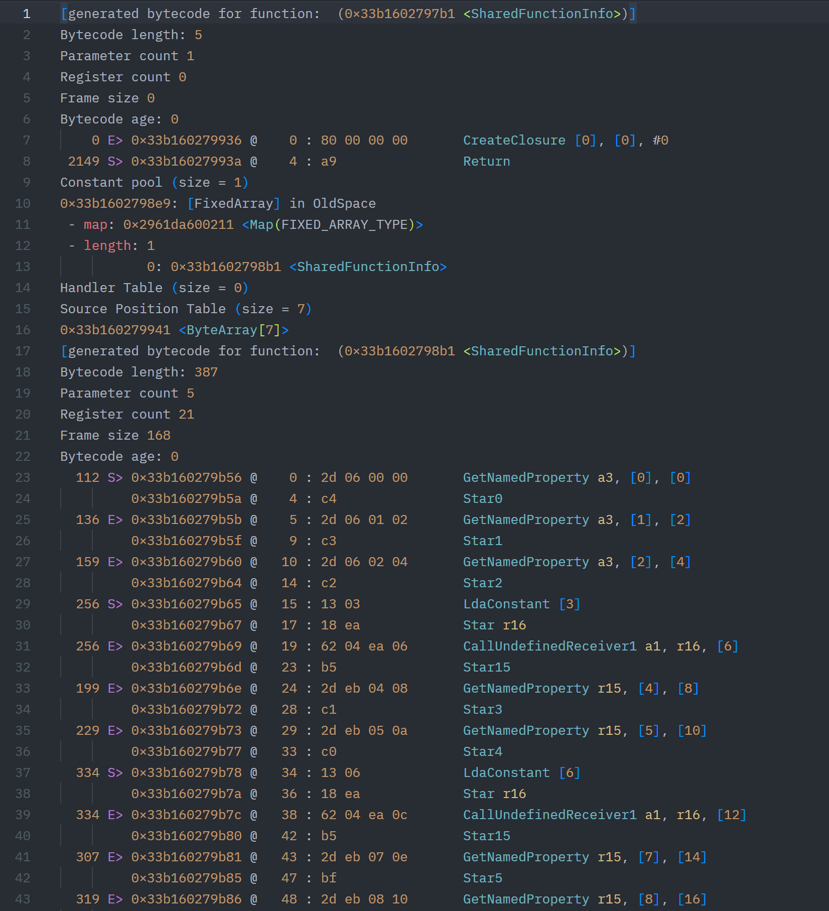
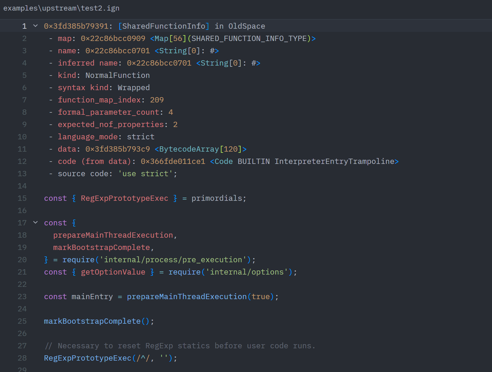

# V8 Ignition Bytecode for Zed

[English](README.md) | [简体中文](README.zh-CN.md)

Syntax highlighting for V8 Ignition bytecode disassembly in Zed, adapted from
[v8-bytecode-highlight](https://github.com/j4k0xb/v8-bytecode-highlight).

- Recognizes `.ign` files and V8 bytecode headers.
- Highlights addresses, offsets, hex bytes, opcodes, registers, and constant pools.
- Supports V8 string representations and bracket matching.
- Highlights embedded source code using Zed's JavaScript grammar.

## Preview

Bytecode instructions, metadata, and constant pool entries:



Embedded JavaScript source:



## Development install

The pull request to the official Zed extension repository has not been merged yet.
Use the development installation below for now.

Requires Node.js and Git.

```sh
npm ci
npm run generate
npm run prepare:dev
```

In Zed, open **Extensions → Install Dev Extension** and select
`.build/dev-extension/` inside this project.
After changing the grammar or language queries, rerun these two preparation commands
and rebuild the development extension in Zed.

## Usage

Open an existing `.ign` file in Zed; the language is detected automatically. If it is
not detected, select **V8 Ignition Bytecode** in the language selector.
You can try `examples/features.ign` included in this project.

String boundaries use the declared UTF-16 length and enclosing tags, including
full-length strings from custom V8 builds. V8's variable-width `u#\x` output can
be ambiguous; the standard truncation marker retains its V8 format meaning.
Long failed scans consume the examined text on the same line, avoiding repeated
rescans and preserving parsing after the next newline.
Unfinished quoted strings also stop at the physical line boundary. Embedded source
ends at the script footer in SharedFunctionInfo dumps or the properties footer in
JSFunction dumps. An identical footer line inside the source remains ambiguous.

## Build and test

```sh
npm run build
npm test
```

### Reuse an existing WASI SDK

Set `WASI_SDK_PATH` to the SDK root directory, containing `bin/clang.exe` on Windows
or `bin/clang` on macOS/Linux. `npm run build` uses this SDK before checking its local
cache. Without the variable, it reuses the cached SDK or downloads one as needed.

Automatically downloaded archives are checked against pinned SHA-256 digests from
the official release before extraction. Incomplete caches and older caches without
a verification marker are recreated. `WASI_SDK_PATH` uses the SDK you specify directly.
Concurrent builds share one SDK installation. If an interrupted installation leaves
an installation lock, the error includes its path; remove it after confirming the
installation process has stopped, then retry.

PowerShell (current terminal session):

```powershell
$env:WASI_SDK_PATH = 'D:\Tools\wasi-sdk'
npm run build
```

macOS/Linux (current terminal session):

```sh
export WASI_SDK_PATH=/opt/wasi-sdk
npm run build
```

Zed versions that support `WASI_SDK_PATH` can also reuse this SDK when installing or
rebuilding a development extension. Fully quit Zed, then run `zed .` from the terminal
where you set the variable so it inherits the setting. You can also configure a user
or system environment variable and restart both the terminal and Zed. A running Zed
process does not automatically read environment changes.

An invalid SDK path causes the project build to fail; Zed logs a warning and falls
back to its own SDK cache or download.

## License

GPL-3.0-only. See [NOTICE.md](NOTICE.md) for attribution and third-party license details.
