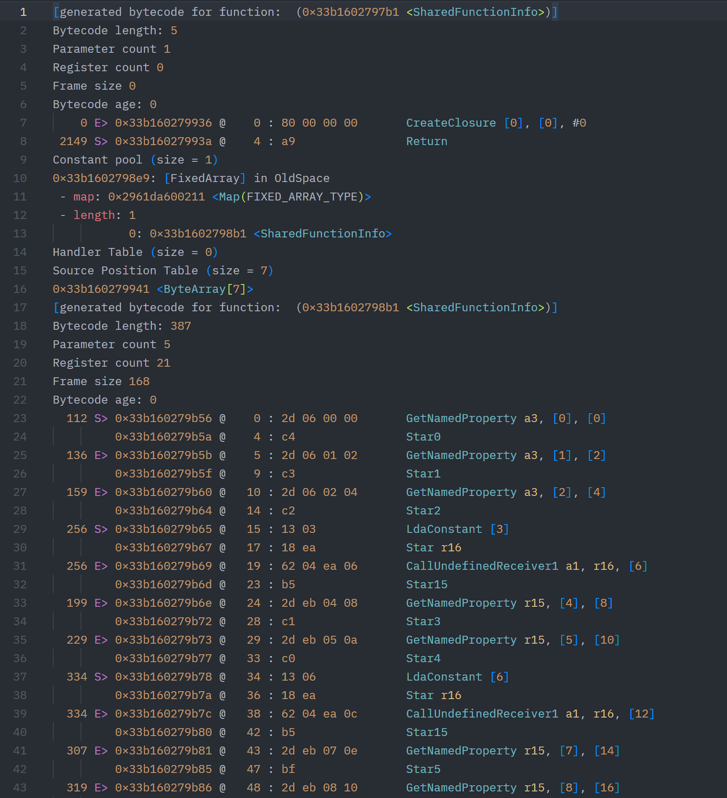
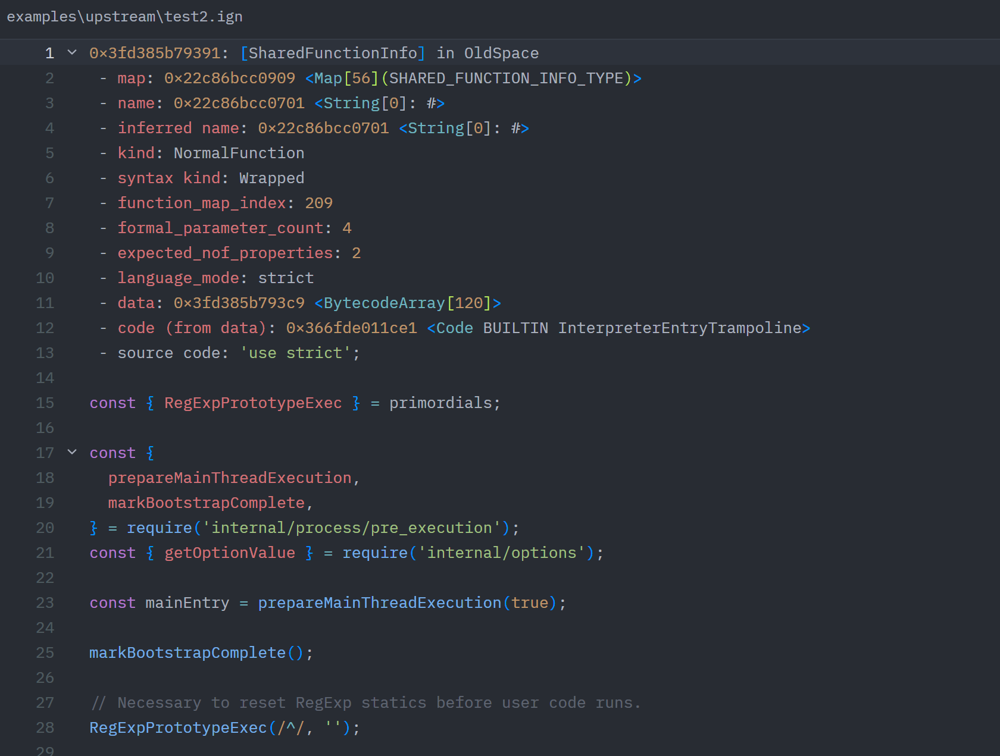

# Zed 的 V8 Ignition 字节码高亮

[English](README.md) | [简体中文](README.zh-CN.md)

为 Zed 提供 V8 Ignition 字节码反汇编高亮，参考
[v8-bytecode-highlight](https://github.com/j4k0xb/v8-bytecode-highlight)。

- 自动识别 `.ign` 文件和 V8 字节码标头。
- 高亮地址、偏移、十六进制字节、操作码、寄存器和常量池。
- 支持 V8 字符串表示和括号匹配。
- 使用 Zed 的 JavaScript 语法高亮嵌入源码。

## 效果展示

字节码指令、元数据和常量池高亮：



嵌入 JavaScript 源码高亮：



## 开发安装

官方扩展仓库的 PR 尚未合并，目前请使用开发安装。

需要 Node.js 和 Git。

```sh
npm ci
npm run generate
npm run prepare:dev
```

在 Zed 中打开 **Extensions → Install Dev Extension**，选择本项目中的
`.build/dev-extension/` 目录。
修改语法或语言查询后，重新运行上述两个准备命令，并在 Zed 中重新构建开发扩展。

## 使用

在 Zed 中打开已有的 `.ign` 文件即可自动识别语言。若未自动识别，通过语言选择器
手动选择 **V8 Ignition Bytecode**。可打开 `examples/features.ign` 查看效果。

## 构建和测试

```sh
npm run build
npm test
```

### 复用已有 WASI SDK

`npm run build` 会优先读取 `WASI_SDK_PATH`。未设置时，构建会复用本项目缓存的
WASI SDK，仅在需要时下载。

变量应指向 SDK 根目录，其中需包含 Windows 下的 `bin/clang.exe`，或 macOS/Linux
下的 `bin/clang`。

PowerShell（当前终端会话）：

```powershell
$env:WASI_SDK_PATH = 'D:\Tools\wasi-sdk'
npm run build
```

macOS/Linux（当前终端会话）：

```sh
export WASI_SDK_PATH=/opt/wasi-sdk
npm run build
```

支持 `WASI_SDK_PATH` 的 Zed 版本在安装和重建开发扩展时也可复用 SDK。先完全退出
Zed，再从设置了变量的终端执行 `zed .`，使 Zed 继承该设置。也可将变量配置为用户或
系统环境变量，再重新启动终端和 Zed。已运行的 Zed 不会自动读取新环境。

若路径无效，本项目构建会报错；Zed 会尝试其 SDK 缓存，并在需要时下载。

## 许可

GPL-3.0-only。归属与第三方许可说明见 [NOTICE.md](NOTICE.md)。
